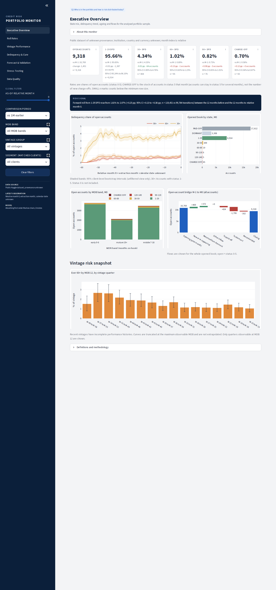
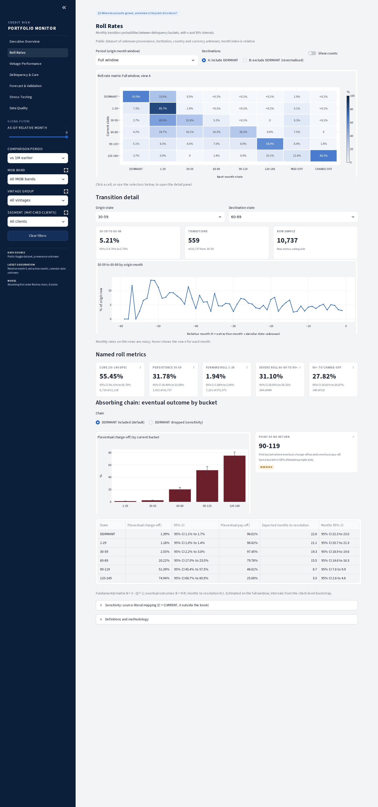
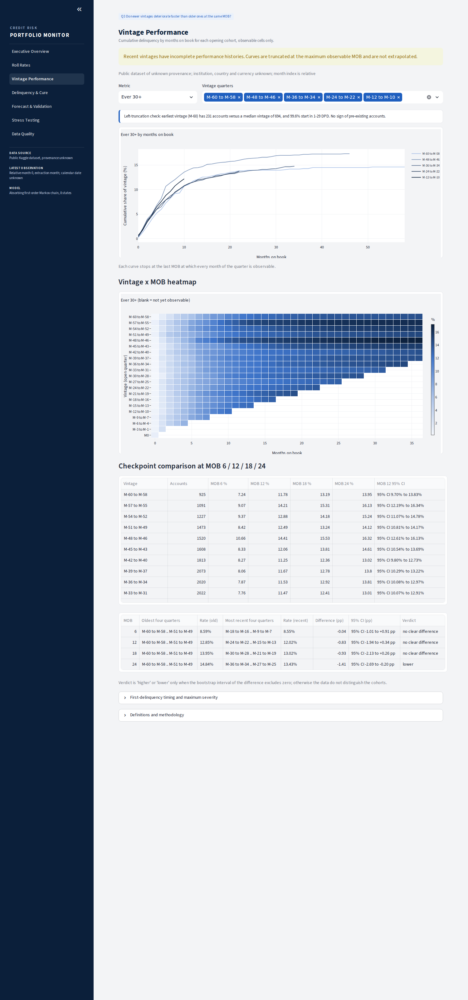
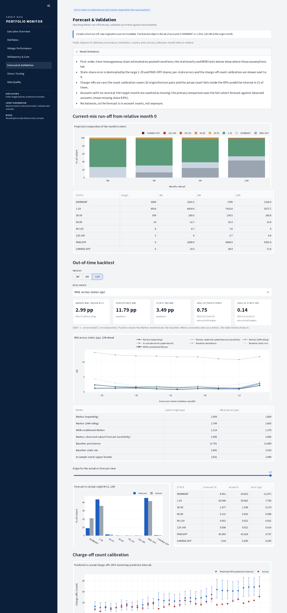
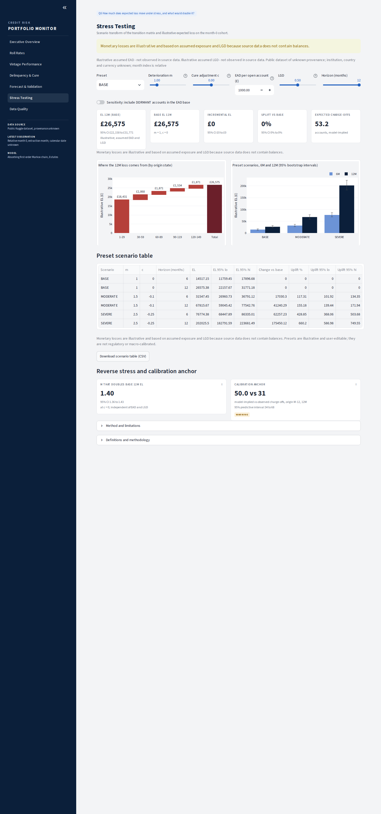
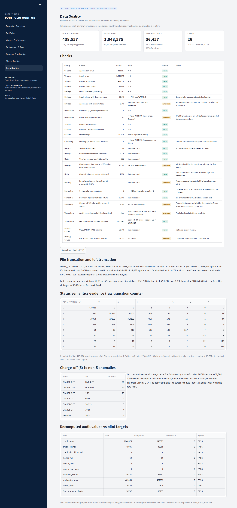
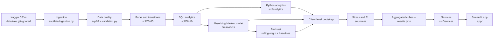

# Credit Card Portfolio Risk Monitor

**Delinquency Migration, Cure and Charge-off Timing**

SQL (DuckDB) + Python + Streamlit. A credit-risk monitoring framework on a public monthly card-status panel: roll rates, cure, vintages, an absorbing Markov chain validated out-of-time against naive baselines, client-level bootstrap intervals, and an illustrative stress-testing module.


## Executive Summary

On <!--r:credit_rows-->1,048,575<!--/r--> monthly status records for <!--r:credit_clients-->45,985<!--/r--> clients (<!--r:opened_clients-->41,448<!--/r--> with at least one open month), the monitor finds:

- **The point of no return is <!--r:pnr_bucket-->90-119<!--/r--> DPD.** An account there eventually charges off with probability <!--r:pnr_pco-->51.4%<!--/r--> (95% CI <!--r:pnr_pco_lo-->45.4%<!--/r--> to <!--r:pnr_pco_hi-->57.5%<!--/r-->); at 60-89 DPD the figure is <!--r:pco_b2-->20.2%<!--/r-->, at 1-29 DPD <!--r:pco_b0-->1.2%<!--/r-->. The same bucket is chosen in <!--r:pnr_share-->68%<!--/r--> of bootstrap replicates, so the cliff is clear but its exact bucket is not certain.
- **Most delinquency cures.** <!--r:cure_cif_3-->87.5%<!--/r--> of 30+ episodes cure within 3 months (95% CI <!--r:cure_cif_3_lo-->86.6%<!--/r--> to <!--r:cure_cif_3_hi-->88.4%<!--/r-->). Entry bucket dominates: 6-month cure is <!--r:cure_e30_6-->95.0%<!--/r--> for entries at 30-59 and <!--r:cure_e60_6-->50.0%<!--/r--> for entries at 60+.
- **The Markov run-off forecast beats persistence by a wide margin and a static mix by a small one.** 12-month out-of-time MAE <!--r:bt_mae_markov_12-->2.99<!--/r--> pp at the latest origin (95% CI <!--r:bt_mae_markov_12_lo-->2.80<!--/r--> to <!--r:bt_mae_markov_12_hi-->3.19<!--/r-->) against <!--r:bt_mae_persist_12-->11.79<!--/r--> pp for persistence and <!--r:bt_mae_static_12-->3.49<!--/r--> pp for a static mix.
- **It over-predicts charge-offs for recent cohorts.** At the latest 12-month origin it implies <!--r:cal_pred_12-->50.0<!--/r--> charge-offs against <!--r:cal_act_12-->31<!--/r--> observed (predictive interval <!--r:cal_lo_12-->34<!--/r--> to <!--r:cal_hi_12-->68<!--/r-->). A MOB-conditioned chain forecasts better (mean 12M MAE <!--r:bt_mae_mob_avg_12-->1.18<!--/r--> vs <!--r:bt_mae_markov_avg_12-->1.81<!--/r--> pp).
- **Losses are steep in deterioration.** A deterioration multiplier of <!--r:rev_m-->1.40<!--/r--> (95% CI <!--r:rev_m_lo-->1.36<!--/r--> to <!--r:rev_m_hi-->1.43<!--/r-->) doubles illustrative 12-month expected loss.

## Problem Statement

> Static delinquency rates show where a card portfolio is today. They do not show where accounts are going. Delinquency is a migration process with two absorbing exits: an account is eventually paid off or charged off. This project builds a monitoring framework on monthly account-level status histories that measures how accounts roll between delinquency buckets, how many cure, where the point of no return lies, how vintages differ at equal months-on-book, and how long accounts take to resolve. It forecasts cohort run-off with an absorbing Markov chain, validates that forecast out-of-time against naive baselines, quantifies uncertainty with client-level bootstrap resampling, and translates the results into stressed expected loss under explicitly assumed exposure and LGD, because the source data has no balances.

## Business Questions

| # | Question | Dashboard page |
|---|---|---|
| Q1 | Who is in the portfolio and how is risk distributed today (state mix, ageing, flows)? | 01 Executive Overview |
| Q2 | Where do accounts go next? Where is the point of no return? | 02 Roll Rates |
| Q3 | Do newer vintages deteriorate faster than older ones at the same MOB? | 03 Vintage Performance |
| Q4 | How many delinquent accounts cure, how fast, and how many charge off instead? | 04 Delinquency & Cure |
| Q5 | Can cohort run-off be forecast 3/6/12 months ahead, out-of-time, better than naive baselines? | 05 Forecast & Validation |
| Q6 | How much does expected loss move under stress, and what would double it? | 06 Stress Testing |
| Q7 | Can the data be trusted for these purposes, and where are its limits? | 07 Data Quality |

## Dashboard Preview

Screenshots captured from the running app by `scripts/capture_screenshots.py` (Playwright, headless Chromium, deploy mode).

| Executive Overview | Roll Rates |
|---|---|
|  |  |
| **Vintage Performance** | **Forecast & Validation** |
|  |  |
| **Stress Testing** | **Data Quality** |
|  |  |

Static chart exports from the same result tables are in `reports/figures/` (labelled 'Chart export').

## Key Findings

Every number below is rendered from `reports/results.json` by `make readme-results`; intervals are 95% client-level bootstrap percentile intervals ({{boot_B}} replicates, <!--r:boot_clients-->41,448<!--/r--> clients).

| Finding | Estimate | 95% CI | n |
|---|---|---|---|
| 30+ DPD share of open accounts, month 0 | <!--r:prev30_m0-->4.34%<!--/r--> | <!--r:prev30_m0_lo-->3.90%<!--/r--> to <!--r:prev30_m0_hi-->4.76%<!--/r--> | <!--r:prev30_m0_n-->404<!--/r--> of <!--r:open_m0-->9,318<!--/r--> |
| 60+ DPD share of open accounts, month 0 | <!--r:prev60_m0-->1.02%<!--/r--> | <!--r:prev60_m0_lo-->0.83%<!--/r--> to <!--r:prev60_m0_hi-->1.23%<!--/r--> | <!--r:prev60_m0_n-->95<!--/r--> |
| Charge-off share of open accounts, month 0 | <!--r:co_m0-->0.70%<!--/r--> | <!--r:co_m0_lo-->0.54%<!--/r--> to <!--r:co_m0_hi-->0.87%<!--/r--> | <!--r:co_m0_n-->65<!--/r--> |
| One-month forward roll from 1-29 DPD | <!--r:forward_b0-->1.9%<!--/r--> | <!--r:forward_b0_lo-->1.9%<!--/r--> to <!--r:forward_b0_hi-->2.0%<!--/r--> | <!--r:forward_b0_n-->372,573<!--/r--> transitions |
| One-month cure from 30-149 DPD | <!--r:cure_30p-->55.4%<!--/r--> | <!--r:cure_30p_lo-->54.1%<!--/r--> to <!--r:cure_30p_hi-->56.8%<!--/r--> | <!--r:cure_30p_n-->12,118<!--/r--> transitions |
| Severe roll 60-89 to 90+ | <!--r:severe_roll-->31.1%<!--/r--> | <!--r:severe_roll_lo-->28.1%<!--/r--> to <!--r:severe_roll_hi-->34.3%<!--/r--> | <!--r:severe_roll_n-->849<!--/r--> transitions |
| 90+ to charge-off next month | <!--r:roll_90p_co-->27.8%<!--/r--> | <!--r:roll_90p_co_lo-->24.8%<!--/r--> to <!--r:roll_90p_co_hi-->30.9%<!--/r--> | <!--r:roll_90p_co_n-->532<!--/r--> transitions |
| P(eventual charge-off) from 1-29 / 30-59 / 60-89 | <!--r:pco_b0-->1.2%<!--/r--> / <!--r:pco_b1-->2.6%<!--/r--> / <!--r:pco_b2-->20.2%<!--/r--> | <!--r:pco_b2_lo-->17.0%<!--/r--> to <!--r:pco_b2_hi-->23.5%<!--/r--> (60-89) | full window |
| P(eventual charge-off) from 90-119 / 120-149 | <!--r:pco_b3-->51.4%<!--/r--> / <!--r:pco_b4-->74.9%<!--/r--> | <!--r:pco_b4_lo-->68.7%<!--/r--> to <!--r:pco_b4_hi-->80.9%<!--/r--> (120-149) | full window |
| Expected months to resolution from 1-29 / 60-89 / 120-149 | <!--r:months_b0-->21.1<!--/r--> / <!--r:months_b2-->15.5<!--/r--> / <!--r:months_b4-->3.5<!--/r--> | see docs/model_validation.md | |
| Cure within 3 months of entering 30+ | <!--r:cure_cif_3-->87.5%<!--/r--> | <!--r:cure_cif_3_lo-->86.6%<!--/r--> to <!--r:cure_cif_3_hi-->88.4%<!--/r--> | <!--r:cure_episodes-->7,575<!--/r--> episodes |
| Charge-off within 6 months of entering 30+ | <!--r:cure_co_6-->3.41%<!--/r--> | <!--r:cure_co_6_lo-->2.88%<!--/r--> to <!--r:cure_co_6_hi-->4.01%<!--/r--> | <!--r:cure_episodes-->7,575<!--/r--> episodes |
| Ever-30+ by MOB 12, recent minus oldest four vintage quarters | <!--r:vint_diff_e30_12-->-0.8 pp<!--/r--> | <!--r:vint_diff_e30_12_lo-->-1.9 pp<!--/r--> to <!--r:vint_diff_e30_12_hi-->+0.3 pp<!--/r--> | verdict: <!--r:vint_verdict_e30_12-->no clear difference<!--/r--> |
| Ever-60+ by MOB 12, recent minus oldest four vintage quarters | <!--r:vint_diff_e60_12-->-1.09 pp<!--/r--> | <!--r:vint_diff_e60_12_lo-->-1.57 pp<!--/r--> to <!--r:vint_diff_e60_12_hi-->-0.63 pp<!--/r--> | verdict: <!--r:vint_verdict_e60_12-->lower<!--/r--> |
| 12M backtest skill vs persistence (latest origin) | <!--r:bt_skill_persist_12-->0.75<!--/r--> | <!--r:bt_skill_persist_12_lo-->0.73<!--/r--> to <!--r:bt_skill_persist_12_hi-->0.76<!--/r--> | wins at <!--r:bt_wins_persist_12-->9<!--/r--> of <!--r:bt_n_origins_12-->9<!--/r--> origins |
| 12M backtest skill vs static mix (latest origin) | <!--r:bt_skill_static_12-->0.14<!--/r--> | <!--r:bt_skill_static_12_lo-->0.12<!--/r--> to <!--r:bt_skill_static_12_hi-->0.17<!--/r--> | wins at <!--r:bt_wins_static_12-->8<!--/r--> of <!--r:bt_n_origins_12-->9<!--/r--> origins |
| Charge-off counts inside 95% predictive interval | <!--r:cal_inside-->21<!--/r--> of <!--r:cal_pairs-->32<!--/r--> pairs | | |
| Illustrative 12M EL, BASE | <!--r:el12_base-->£26,575<!--/r--> | <!--r:el12_base_lo-->£22,158<!--/r--> to <!--r:el12_base_hi-->£31,771<!--/r--> | EAD <!--r:ead-->£1,000<!--/r-->, LGD <!--r:lgd-->50%<!--/r--> (assumed) |
| Illustrative 12M EL, SEVERE (m = 2.5, c = -25%) | <!--r:el12_sev-->£202,025<!--/r--> | <!--r:el12_sev_lo-->£182,792<!--/r--> to <!--r:el12_sev_hi-->£223,681<!--/r--> | uplift <!--r:el12_sev_uplift-->660%<!--/r--> |
| Multiplier m that doubles base 12M EL | <!--r:rev_m-->1.40<!--/r--> | <!--r:rev_m_lo-->1.36<!--/r--> to <!--r:rev_m_hi-->1.43<!--/r--> | at c = 0 |

What the data do not support: a ranking of vintages beyond the verdicts above, a stable point-of-no-return bucket in every replicate, and any statement about real monetary loss.

## Data and Licence

Kaggle dataset `rikdifos/credit-card-approval-prediction`: `application_record.csv` (applicant attributes, key `ID`) and `credit_record.csv` (`ID`, `MONTHS_BALANCE`, `STATUS`). Its provenance is stated as unknown; institution, country, currency and calendar dates are unknown, and `MONTHS_BALANCE` is a relative index (0 = extraction month).

The licence could not be read from the build environment, so `docs/data_licence.md` says **UNVERIFIED - human must check**. The repository follows the safe default: **no raw rows and no client-level table are committed**. Only aggregated cubes in `data/processed/cubes/` (no ID column; cells with demographics below 5 accounts suppressed), `data/processed/backtest_results.parquet` and `reports/*.json` are tracked. `tests/test_committed_data.py` and the verifier enforce this.

To regenerate everything: download both CSVs (or the zip) from Kaggle into `data/raw/` and run `make build`.

## Methodology

Raw CSVs are typed and audited in DuckDB (`sql/01`-`02`), cleaned (`03`), turned into an ID x month panel with months on book (`04`), consecutive-month transitions (`05`), roll-rate matrices (`06`), vintage curves (`07`), cure episodes (`08`), stock and flow tables (`09`) and segment metrics (`10`). The SQL is executed by `src/pipeline.py` and reconciled against an independent pandas implementation in the tests. Python reads the SQL outputs to fit the absorbing chain, run the backtest and bootstrap, and compute stress scenarios. Full detail: `docs/methodology.md`.

## State Definitions and Why C Is Not Current

| Raw | State | Class |
|---|---|---|
| 0 | 1-29 DPD | open, transient (behaves as the performing bucket; headline delinquency is 30+) |
| 1 / 2 / 3 / 4 | 30-59 / 60-89 / 90-119 / 120-149 DPD | open, transient |
| 5 | CHARGE-OFF | absorbing (<!--r:co_anomaly_n-->107<!--/r--> of <!--r:co_anomaly_den-->1,564<!--/r--> non-X transitions leave it; flagged, not fixed) |
| C | PAID-OFF | absorbing exit |
| X | DORMANT | transient, outside the open book |

**Why C is not current:** of <!--r:c_total-->419,324<!--/r--> consecutive transitions out of C, <!--r:c_to_c-->419,323<!--/r--> stay in C and <!--r:c_to_open-->1<!--/r--> returns to an open status. Read literally as CURRENT, C would be <!--r:lit_current_share-->65.4%<!--/r--> of non-X accounts at month 0 with a deterioration probability of <!--r:lit_current_det-->0.000%<!--/r--> per month: a state that can never go bad. **Why X is not an exit:** <!--r:dormant_return-->54%<!--/r--> of accounts that go dormant later return. Evidence: `docs/status_semantics.md`.

Definitions: open account = status 0-5; 30+ = status 1-5 (status 0 excluded); 60+ = 2-5; 90+ = 3-5; charge-off = 5; cure = from a 30+ bucket to 1-29 DPD or PAID-OFF; MOB counted from the first non-X month.

## Roll Rates

One-month transition matrices over <!--r:transitions_n-->439,857<!--/r--> consecutive-month transitions, by calendar window, MOB band, vintage quarter and segment, in two views: A keeps DORMANT as a destination, B renormalises over open and absorbing destinations. Every cell carries n and a bootstrap interval; rows below 30 transitions are suppressed and rows below 100 flagged. Named metrics: cure, persistence, forward roll, 30-59 to 60+, 60-89 to 90+, 90+ to charge-off.

## Vintage Analysis

Vintage = first non-X month. A vintage x MOB cell exists only if open month + MOB <= 0; denominators include accounts that later paid off, went dormant or whose records ended, so early-closing accounts cannot flatter a curve. Curves stop at the last observable MOB and are never extrapolated. Recent vintages are compared with the oldest at MOB 6/12/18/24 with bootstrap intervals for the difference; the verdict is 'no clear difference' unless the interval excludes zero.

## Cure Analysis

A 30+ episode starts in a month with status 1-5 whose previous calendar month was not 1-5; episodes whose first open month is already 30+ are left-censored and excluded. Outcomes within 1/2/3/6 months are looked up by calendar month: cured, charged-off, still 30+, or censored (data end or a dormant month). The primary estimator is a discrete-time cumulative incidence with competing risks and censoring, so recent episodes count; a fixed-window estimator (complete windows only) is shown beside it. <!--r:redelinq_6m-->31.3%<!--/r--> of cured episodes with a full 6-month window are 30+ again within 6 months.

## Absorbing Markov Forecasting

Transient states {DORMANT, 1-29, 30-59, 60-89, 90-119, 120-149}; absorbing {PAID-OFF, CHARGE-OFF}. With Q (transient to transient) and R (transient to absorbing), N = (I - Q)^-1, eventual outcomes B = N R and expected months to resolution N 1. The point of no return is the first bucket where eventual charge-off is more likely than pay-off: <!--r:pnr_bucket-->90-119<!--/r--> with DORMANT included and <!--r:pnr_bucket_x-->90-119<!--/r--> with X dropped. Forecasts are closed-cohort run-off, pi P^k for k = 3, 6, 12, with no new originations.

## Out-of-Time Validation and Baselines

Rolling origins every 3 months (<!--r:bt_origins-->12<!--/r--> origins, <!--r:bt_pairs-->32<!--/r--> origin x horizon pairs), training only on transitions whose destination month is at or before the origin (a unit test enforces this). Expanding and 24-month rolling matrices are compared with two naive baselines (persistence; static portfolio mix) and an in-sample oracle shown only as an upper bound. Metrics: MAE and RMSE across states, maximum error, 30+/60+/90+ share-of-open error, cumulative charge-off error, and charge-off count calibration with bootstrap predictive intervals. Skill = 1 - error(model) / error(baseline).

Is first-order Markov enough? <!--r:stat_reject-->4<!--/r--> of <!--r:stat_rows-->6<!--/r--> origin rows differ between the two halves of the window, <!--r:mob_reject-->6<!--/r--> of <!--r:mob_rows-->6<!--/r--> differ across MOB bands, and the MOB-conditioned chain (band matrices applied in sequence as MOB advances, Dirichlet smoothing tuned on training data) has lower mean 12M error (<!--r:bt_mae_mob_avg_12-->1.18<!--/r--> vs <!--r:bt_mae_markov_avg_12-->1.81<!--/r--> pp). Full results: `docs/model_validation.md`.

## Bootstrap

The resampling unit is the client: each replicate draws clients with replacement and keeps whole histories. Every metric is a function of counts that sum over clients, so a replicate is a weight vector w and its counts are w @ S, where S holds each client's sufficient statistics (sparse, <!--r:boot_clients-->41,448<!--/r--> clients). {{boot_B}} replicates with a fixed seed cover roll-rate cells, prevalence, cure curves, vintage checkpoints, absorbing outcomes, the full backtest (training matrix re-estimated and origin cohort resampled with the same weights) and expected loss. Cells where at least half the replicates are exactly zero are flagged so an upper bound is reported instead of [0, 0]. The app never resamples.

## Stress Testing

For each transient row, transitions to worse buckets are multiplied by m (capped at 1), transitions to better buckets and PAID-OFF by (1 + c), and the residual goes to staying or dormant; rows always sum to 1. Presets: BASE (m = 1, c = 0), MODERATE (m = 1.5, c = -10%), SEVERE (m = 2.5, c = -25%), all illustrative and user-editable. EL_h = sum over origin states of n_s x EAD x PD_h(s) x LGD with PD_h(s) = (P'^h)[s, CHARGE-OFF]. The cohort is the <!--r:cohort_open_m0-->9,253<!--/r--> accounts in 1-29 to 120-149 at month 0; the <!--r:cohort_dormant_m0-->3,308<!--/r--> dormant accounts carry EAD 0 (a sensitivity includes them). Reverse stress finds the smallest m that doubles base 12-month EL.

*Monetary losses are illustrative and based on assumed exposure and LGD because source data does not contain balances.*

## Assumptions

- Illustrative assumed EAD - not observed in source data. Default <!--r:ead-->£1,000<!--/r--> per open account, currency symbol <!--r:currency-->£<!--/r--> (the source currency is unknown).
- Illustrative assumed LGD - not observed in source data. Default <!--r:lgd-->50%<!--/r-->.
- C = PAID-OFF, X = DORMANT, 0 = 1-29 DPD, chosen from transition evidence (`docs/status_semantics.md`).
- CHARGE-OFF is absorbing in the model; the raw leak is reported as a sensitivity (<!--r:anomaly_co12_leak-->42.7<!--/r--> vs <!--r:anomaly_co12_abs-->71.6<!--/r--> model-implied charge-offs in 12 months).
- More: `docs/assumptions.md`.

## Data Limitations

- No balances, limits, recoveries, interest or calendar dates; month 0 is the extraction month.
- credit_record.csv is cut at Excel's row limit (test <!--r:trunc_fired-->fired<!--/r-->); <!--r:app_above_cut-->402,053<!--/r--> application IDs above the last credit ID have no credit history. The truncated final client is excluded.
- Only <!--r:matched_clients-->36,457<!--/r--> credit clients have demographics; segment results apply to matched clients only.
- Charge-offs are rare at month 0 (<!--r:co_m0_n-->65<!--/r--> accounts), so severe-bucket intervals are wide.
- <!--r:dq_warn-->7<!--/r--> of <!--r:dq_checks-->26<!--/r--> data-quality rules end in WARNING and <!--r:dq_fail-->0<!--/r--> in FAIL (`docs/data_audit.md`).

## Architecture



Layering is strict: page (layout and widgets) to service to analytics/model to data. Details: `docs/architecture.md`.

## Repository Structure

```
app/            Streamlit entry point, seven pages, components (design system), CSS
src/data/       ingestion, SQL runner, cleaning, validation, pandas reference implementation
src/analytics/  roll rates, cure incidence, vintages, ageing, segmentation
src/models/     Markov chain, absorbing analytics, backtest, MOB-conditioned model, bootstrap
src/stress/     scenario transform, expected loss, run-off forecasts
src/services/   UI-facing functions that read the cubes
sql/            01_schema .. 10_segmentation (DuckDB, executed by the pipeline)
notebooks/      four executed narrative notebooks over src
tests/          pytest suite on synthetic fixtures and committed cubes, AppTest for every page
docs/           methodology, data dictionary, assumptions, validation, audit, decisions, checkpoints
data/processed/ aggregated cubes (committed) ; data/raw/ git-ignored
reports/        results.json, dq_report.json, model_validation/, figures/
scripts/        verifier, README renderer, screenshots, packaging
```

## Installation

Python 3.12 (3.11+ supported).

```bash
make setup                 # virtualenv + requirements-dev.txt + Playwright Chromium
source .venv/bin/activate
```

## Running Locally

```bash
make app                   # deploy mode: committed cubes only, no raw data needed
# to rebuild every artefact from raw data:
#   put application_record.csv and credit_record.csv (or the Kaggle zip) in data/raw/
make build                 # SQL layer, analytics, bootstrap, backtest, stress, cubes, docs
make readme-results        # re-render numbers in README and docs from results.json
make screenshots           # Playwright screenshots of the running app
make verify                # full deliverables verifier
```

## Streamlit Deployment

Streamlit Community Cloud: repository = your fork, branch `main`, main file `app/streamlit_app.py`, Python 3.12, no secrets needed (`CCRM_DATA_MODE` defaults to `deploy`). The app reads only the committed cubes. A `Dockerfile` is included for container hosting. Steps: `docs/deployment.md`.

## Testing

```bash
make test    # pytest: SQL-vs-pandas reconciliation, Markov, bootstrap, stress, cure, vintage, AppTest pages
make lint    # ruff check + ruff format --check
```

CI (`.github/workflows/ci.yml`) runs lint and tests on synthetic fixtures and the committed cubes; it has no raw data.

## Limitations

- Expected loss is illustrative: flat assumed EAD, assumed LGD, no recoveries timing, no discounting, no new originations, not IFRS 9 or CECL, 12-month horizon only.
- The pooled first-order chain is not time-homogeneous or MOB-independent in this data, and over-predicts charge-offs at recent origins.
- Severe-bucket rows are thin; read intervals before any comparison.
- Segment cubes are not cross-classified by MOB band or vintage, so those filters do not apply when a segment is selected.
- Provenance and licence of the dataset are unverified.

## Future Improvements

- Balances and limits to model EAD and credit conversion, then loss in money rather than counts.
- Macro overlays to calibrate stress multipliers.
- Survival models (cause-specific Cox or discrete-time hazard with covariates) for time to charge-off.
- IFRS 9 staging and lifetime expected loss once exposure data exist.

## Licence

Code: MIT (`LICENSE`). Data: not redistributed; licence unverified (`docs/data_licence.md`).
