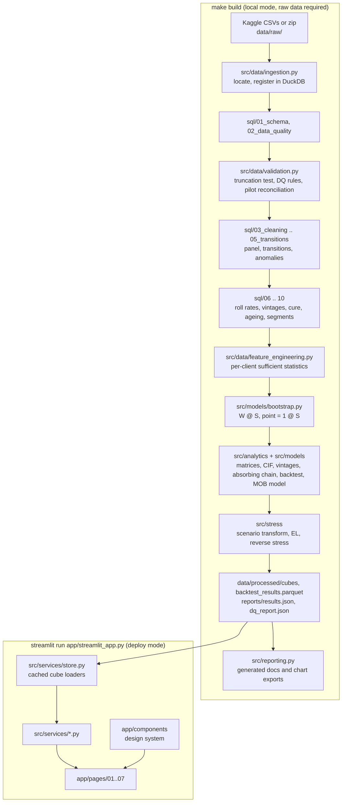

# Architecture

Layering is strict: **page (UI) -> service -> analytics / model -> data layer**. Pages hold layout
and widget wiring only; services read the committed cubes and call analytics functions for any
slicing; analytics and models are pure functions over arrays and DataFrames; the data layer is
DuckDB SQL executed by the pipeline.

## Data modes

- `CCRM_DATA_MODE=deploy` (default): the app reads only committed aggregated artefacts. This is what Streamlit Community Cloud runs.
- `CCRM_DATA_MODE=local`: as deploy, and if a cube is missing the services rebuild every artefact from the raw files by calling `src.pipeline.run`.

## Caching

`st.cache_data` wraps the parquet and JSON loaders (keyed on path and modification time) and the pure stress computations (keyed on m, c, EAD, LGD, horizon and the dormant toggle). Widget state is never cached; `tests/test_app.py` checks that changing a filter or a stress control changes the output.

## Timings (from the latest build)

`reports/results.json` -> `timings` records the wall time of every SQL script and build step. The whole build runs in well under a minute on a laptop-class machine because heavy aggregation is in DuckDB and the bootstrap is a sparse matrix product.

## Testing layers

- SQL vs independent pandas implementation on synthetic fixtures (`tests/test_panel_sql.py`, `tests/test_vintage_cure_sql.py`, `tests/test_validation.py`).
- Model mathematics and no-leakage (`tests/test_markov.py`), bootstrap integrity (`tests/test_bootstrap.py`), stress properties (`tests/test_stress.py`).
- Committed-data guarantees (`tests/test_committed_data.py`), services against results.json (`tests/test_services.py`), AppTest for every page with default and extreme filters (`tests/test_app.py`).
